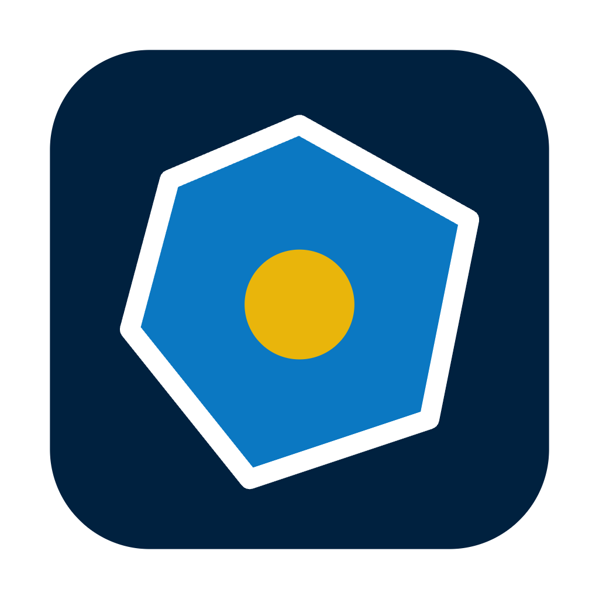
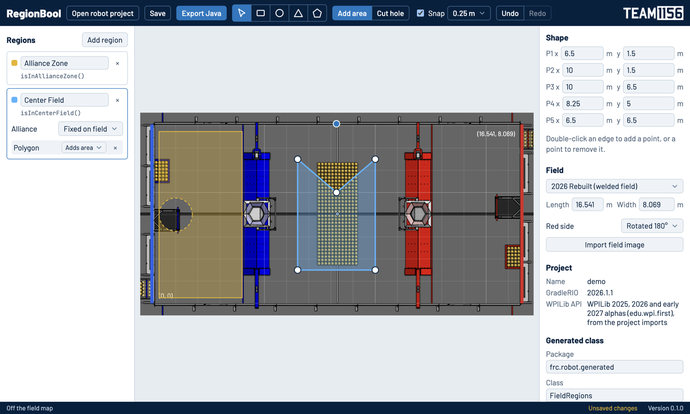
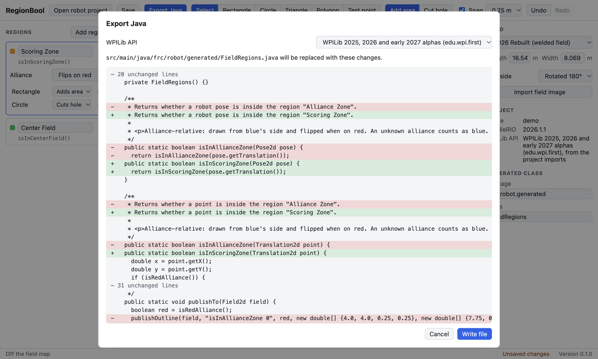

# RegionBool



Draw regions on an FRC field, and get a boolean Java method for each one in your WPILib robot project.

Instead of hand-writing and guessing at coordinate checks, you draw the area on the field and call the generated method:

```java
if (FieldRegions.isInScoringZone(drivetrain.getPose())) {
  // The robot is in the scoring zone.
}
```



## Features

- **Shapes:** rectangles, circles, triangles and free polygons, all rotatable. Combine shapes in one region, and cut holes out of it.
- **Alliance handling:** set each region to flip on red or stay fixed on the field. The generated code flips the right way for that season.
- **Safe export:** you see a diff before anything is written. RegionBool won't replace a file it didn't generate.
- **Field images:** 2022 to 2026 are included, or import your own image.
- **See your regions in dashboards:** generated classes can publish their outlines for AdvantageScope, Glass or Elastic.
- **Made for teams:** regions are saved in your project as readable JSON, so they go through git like the rest of your code.

## Install

Download the installer for your system from the [releases page](https://github.com/Arthur225/regionbool/releases).

| System  | File                                                                             |
| ------- | -------------------------------------------------------------------------------- |
| Windows | `RegionBool-<version>-win-x64.exe`                                               |
| macOS   | `RegionBool-<version>-mac-arm64.dmg` for Apple Silicon, `-mac-x64.dmg` for Intel |
| Linux   | `RegionBool-<version>-linux-x86_64.AppImage`                                     |

Builds aren't signed with a developer certificate yet, so your system will warn you:

- **Windows:** on the SmartScreen warning, choose **More info**, then **Run anyway**.
- **macOS:** the system may refuse to open the app, or call it damaged. After dragging it to Applications, run this:

  ```bash
  xattr -cr /Applications/RegionBool.app
  ```

- **Linux:** mark the AppImage as executable, then run it.

## How to use it

1. **Open your robot project** with **Open robot project**. RegionBool works out which WPILib imports your project uses, and the button then shows the project's name. Click it again to open a different one. The next time you start RegionBool, it reopens your last project.
2. **Pick the field** in the right panel. 2025 and 2026 have separate welded and AndyMark fields, because their sizes differ. Check which your event uses.
3. **Draw.** Pick a shape tool and draw on the field. Your first shape creates a region. Use **Cut hole** to subtract from it, and the panels on either side to rename it or type exact values.
4. **Check it.** Compare the outlines with the field image, and type exact values when precision matters, since the image is a guide. Regions that flip are drawn on the blue side here, and the generated code moves them on red.
5. **Export.** **Export Java** shows what will change, and **Write file** writes it. By default that's `src/main/java/frc/robot/generated/FieldRegions.java`.
6. **Commit** both the generated class and the `.regionbool` folder, so your team can keep editing the regions.



### Using the generated code

Each region gets two methods, taking a `Pose2d` or a `Translation2d`. Region checks don't allocate, so they're safe to call every loop.

```java
boolean inZone = FieldRegions.isInScoringZone(pose);
boolean pieceInZone = FieldRegions.isInScoringZone(gamePieceTranslation);
```

To see your regions in a dashboard, publish their outlines. These allocate, so call them at startup or when your alliance changes, not every loop.

```java
// AdvantageScope: find them under RegionBool in the sidebar, and add them to a 2D Field tab.
FieldRegions.publishToNetworkTables();

// Glass or Elastic. AdvantageScope warns about this older format.
FieldRegions.publishTo(field2d);

// Your own logger, such as AdvantageKit.
FieldRegions.forEachOutline((name, poses) -> Logger.recordOutput("Regions/" + name, poses));
```

### Good to know

- **Alliance:** regions that flip use the alliance from WPILib. Until the alliance is known, they act as if you're on blue.
- **Edges:** a point exactly on an edge counts as inside a shape, so a point exactly on a hole's edge is outside the region.
- **After a `git pull`:** reopen the project before saving, because RegionBool doesn't notice `regions.json` changing while it's open.
- **Formatters:** Spotless and similar tools can reformat the generated class safely. RegionBool ignores formatting and comments when it checks for hand edits.
- **WPILib versions:** 2025, 2026 and the 2027 alphas are supported, and generated code has been run against 2026.2.1 and 2027 alpha-8. The 2027 API is still changing, so a later alpha may need an update.

## Development

See [CONTRIBUTING.md](CONTRIBUTING.md). [AGENTS.md](AGENTS.md) maps the code and lists the rules it follows, for developers and AI agents alike.

## License

[MIT](LICENSE): you can do what you want with RegionBool, as long as you keep the copyright and license notice.

Java code that RegionBool generates in your project is yours, with no notice needed. Field images come from WPILib and others, aren't this project's work and aren't covered by this license. See [resources/fields/SOURCES.md](resources/fields/SOURCES.md). The UnderControl 1156 logo belongs to the team, and the bundled fonts are under the [SIL Open Font License](resources/third-party).
