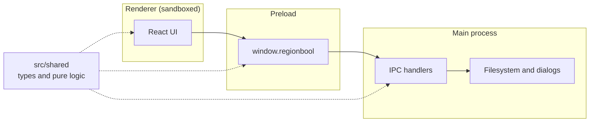
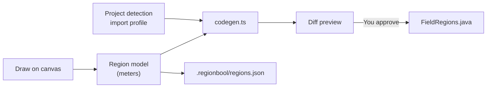

# Architecture

RegionBool follows Electron's standard three-part structure, plus a fourth folder of shared code.

| Part     | Folder         | Can access                       | Responsible for                       |
| -------- | -------------- | -------------------------------- | ------------------------------------- |
| Main     | `src/main`     | Node, Electron, the filesystem   | Windows, dialogs, reading and writing |
| Preload  | `src/preload`  | `contextBridge`, `ipcRenderer`   | Exposing a small named API            |
| Renderer | `src/renderer` | DOM and `window.regionbool` only | All UI                                |
| Shared   | `src/shared`   | Nothing process-specific         | Types and logic used on every side    |

## Security model

The renderer will display data read from robot projects, such as region names and imported images, so it's treated as untrusted:

- The window runs with `contextIsolation`, `sandbox` and no `nodeIntegration`.
- A Content Security Policy in `src/renderer/index.html` allows only the app's own scripts.
- The window can't navigate away from its page. External https links open in the system browser, and other link types are refused.
- The preload script exposes individual methods, never `ipcRenderer`.

## IPC surface

`src/shared/ipc.ts` is the complete list of what the renderer can ask the main process to do.

| Channel               | Purpose                                                               |
| --------------------- | --------------------------------------------------------------------- |
| `app:get-info`        | Returns the app and Electron versions                                 |
| `project:open`        | Shows a folder picker and makes the choice the current project        |
| `project:open-last`   | Reopens the remembered project, once per launch                       |
| `project:close`       | Forgets the current project, leaving the disk unchanged               |
| `project:save`        | Saves region data to `.regionbool/regions.json`                       |
| `project:get-current` | Returns the current project                                           |
| `export:preview`      | Generates code and compares it with the file on disk, without writing |
| `export:write`        | Writes generated code, if the preview still holds                     |
| `fields:list`         | Lists bundled fields and the current project's fields                 |
| `fields:get-image`    | Returns a field's image as a data URL                                 |

The renderer never sends a path or file contents. It can't name a folder, only ask the user to pick one, and it sends region data rather than code, which the main process checks and generates from. So even a compromised renderer can only write generated Java to the project the user chose.

## Main process modules

| Module        | Responsibility                                                     | Imports Electron |
| ------------- | ------------------------------------------------------------------ | ---------------- |
| `index.ts`    | Window and app lifecycle                                           | Yes              |
| `ipc.ts`      | Channel handlers, and holds the current project                    | Yes              |
| `project.ts`  | Recognizes WPILib Java projects and detects the import profile     | No               |
| `export.ts`   | Validates region data, generates code, applies the overwrite rules | No               |
| `writer.ts`   | Atomic writes that can't leave the project                         | No               |
| `settings.ts` | Remembers the last project for this computer                       | No               |
| `fields.ts`   | Loads field definitions and images                                 | No               |

Modules that don't import Electron can be tested directly with Vitest.

## Writing files safely

`export:write` refuses in these cases, and each has a test:

- **The file isn't ours:** its first line isn't the RegionBool header.
- **The file changed after the preview:** its hash differs from the one the user approved.
- **`regions.json` can't be read:** nothing is written, so a broken file can't be replaced.
- **The path leaves the project:** through `..`, an absolute path, or a symbolic link at any level.

Writes go to a temporary file beside the target, then get renamed into place, so a crash can't leave a half-written file.

## Data flow

Drawing on the canvas changes the region model, and everything else is derived from it.

The model and code generator are pure functions in `src/shared`, so they can be tested without Electron. The main process only reads and writes the results.

## Build tooling

`electron-vite` bundles all three processes into `out/`. The preload script is emitted as CommonJS, which sandboxed preload scripts require. That's why `package.json` doesn't set `"type": "module"`.

`electron-builder` then packages `out/` into installers, following `electron-builder.yml`. `resources/fields` is copied outside the app archive into Electron's resources folder, where `bundledFieldsDir` in `src/main/ipc.ts` finds it. The renderer's libraries are bundled by Vite, so they're dev dependencies. Only what the main process loads at run time, currently `ajv`, belongs in `dependencies`.
