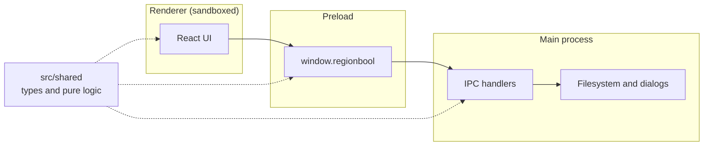
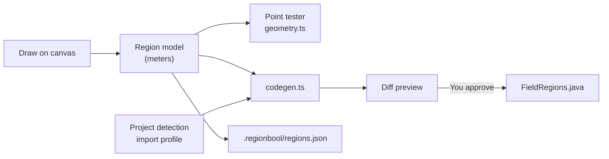

# Architecture

RegionBool follows Electron's standard three-part structure, plus a fourth folder of shared code.

| Part     | Folder         | Can access                       | Responsible for                       |
| -------- | -------------- | -------------------------------- | ------------------------------------- |
| Main     | `src/main`     | Node, Electron, the filesystem   | Windows, dialogs, reading and writing |
| Preload  | `src/preload`  | `contextBridge`, `ipcRenderer`   | Exposing a small named API            |
| Renderer | `src/renderer` | DOM and `window.regionbool` only | All UI                                |
| Shared   | `src/shared`   | Nothing process-specific         | Types and logic used on every side    |

## Security model

The renderer will display data read from robot projects, such as region names and imported images, so it's treated as untrusted:

- The window runs with `contextIsolation`, `sandbox` and no `nodeIntegration`.
- A Content Security Policy in `src/renderer/index.html` allows only the app's own scripts.
- The window can't navigate away from its page. External https links open in the system browser, and other link types are refused.
- The preload script exposes individual methods, never `ipcRenderer`.

## IPC surface

`src/shared/ipc.ts` is the complete list of what the renderer can ask the main process to do.

| Channel        | Purpose                               |
| -------------- | ------------------------------------- |
| `app:get-info` | Returns the app and Electron versions |

## Planned data flow

This is the design for the finished app. The model, `geometry.ts` and `codegen.ts` exist, and the rest comes in later build steps.

The model and code generator are pure functions in `src/shared`, so they can be tested without Electron. The main process only reads and writes the results.

## Build tooling

`electron-vite` bundles all three processes into `out/`. The preload script is emitted as CommonJS, which sandboxed preload scripts require. That's why `package.json` doesn't set `"type": "module"`.
